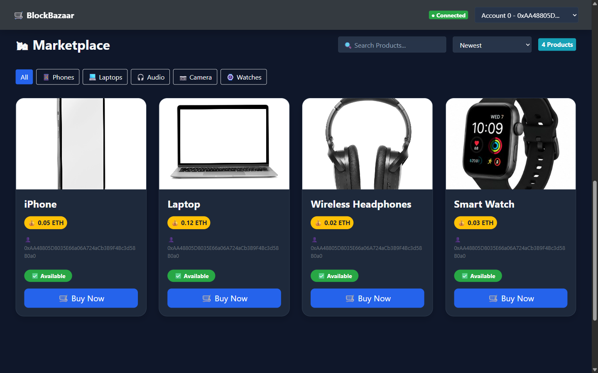
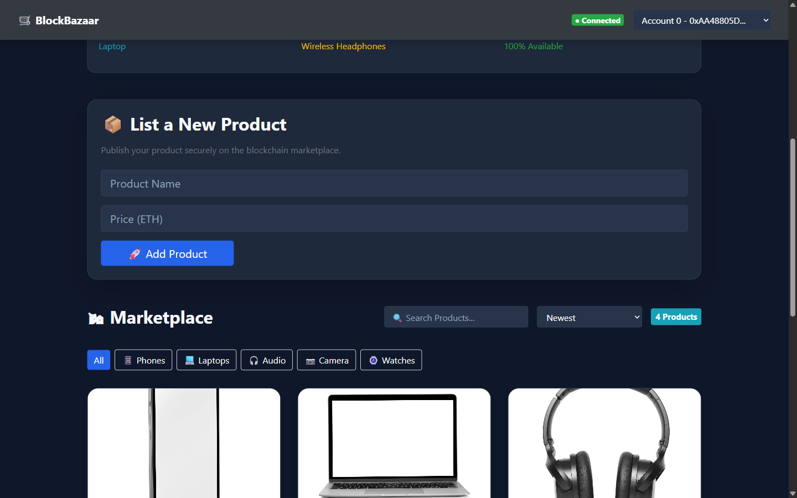

# BlockBazaar

[](https://github.com/rohan26-bit/blockbazaar/actions/workflows/ci.yml)
A blockchain-based marketplace prototype where users can list products and purchase them through an Ethereum smart contract. The project uses a React interface, Web3.js, Solidity, Truffle, and a local Ganache development network.

## Overview

BlockBazaar demonstrates how a web application can interact with a smart contract for marketplace operations. Product records are stored in the `Marketplace` contract, and purchases are submitted as Ethereum transactions on the configured development chain.

## Features

- Create product listings with a name and ETH price.
- Purchase listed products through the marketplace smart contract.
- Transfer product ownership to the buyer after a successful purchase.
- Display marketplace products and transaction-related state.
- Search products and filter the marketplace by category.
- Sort products by recency or price, and filter for available products.
- View basic marketplace insights, including highest-priced, lowest-priced, and available products.
- Switch between accounts provided by the local Ganache network.

## Screenshots

### Marketplace Overview

*Populated marketplace view showing product listings with prices in ETH, ownership details, and availability status on the local development blockchain.*

### Product Listing Interface

*The product listing interface allowing users to publish new items and set ETH prices directly through the smart contract.*

## Technology stack

| Layer | Technologies |
|---|---|
| Frontend | React 16, JavaScript, Bootstrap 4, CSS |
| Blockchain interaction | Web3.js 1.x |
| Smart contracts | Solidity 0.5.x |
| Development and migrations | Truffle 5 |
| Local blockchain | Ganache |
| Testing | Truffle tests, Mocha, Chai |

## Architecture

```text
React application
       |
       v
     Web3.js
       |
       v
Local Ganache node
(127.0.0.1:7545)
       |
       v
Marketplace.sol
       |
       v
Product listings and ETH payments
```

The current frontend connects directly to the local JSON-RPC endpoint at `http://127.0.0.1:7545`. This repository is configured for local development; it does not document a public mainnet deployment or a MetaMask-based wallet connection.

## Prerequisites

- Node.js and npm
- Ganache (GUI or CLI), listening on `127.0.0.1:7545`
- A browser

This project uses an older React Scripts and Truffle toolchain. Use a Node.js version compatible with the dependencies in `package.json`.

## Run locally

### 1. Install dependencies

From the repository root:

```bash
npm install
```

### 2. Start Ganache

Start a local Ganache workspace and confirm that its JSON-RPC server is available at:

```text
http://127.0.0.1:7545
```

The Truffle development network in `truffle-config.js` uses this host and port.

### 3. Compile and deploy the smart contracts

In a terminal at the repository root:

```bash
npx truffle compile
npx truffle migrate --reset --network development
```

### 4. Start the React application

```bash
npm start
```

Open the local URL printed by the development server. Keep Ganache running while using the application.

## Run smart contract tests

With Ganache available, run:

```bash
npx truffle test --network development
```

The marketplace tests cover contract deployment, product creation, listing retrieval, and purchase validation.

## Project structure

```text
blockbazaar/
├── migrations/          # Truffle migration scripts
├── public/              # Static web assets
├── src/
│   ├── abis/            # Contract ABI and deployment data
│   ├── assets/          # Product images and other assets
│   ├── components/      # React UI components
│   └── contracts/       # Solidity smart contracts
├── test/                # Smart contract tests
├── package.json
├── truffle-config.js
└── README.md
```

## Important notes

- Run the app against the local Ganache network configured in `truffle-config.js`.
- Restart the local deployment with `npx truffle migrate --reset --network development` if the contract needs to be redeployed.
- Do not use real funds or treat this local prototype as a production marketplace.

## Learning reference and attribution

The core `Marketplace` smart-contract structure and its product creation and purchase flow follow the educational example in [Dapp University's Ethereum marketplace tutorial](https://dappuniversity.com/articles/how-to-build-a-blockchain-app). The corresponding [Dapp University marketplace source](https://github.com/dappuniversity/marketplace) is a useful reference for the original learning material.

This repository is a modified academic prototype. Its project interface, presentation, filtering, insights, and local development adjustments are maintained in this repository. The tutorial reference is acknowledged here to distinguish the educational starting point from this project's modifications.


## License

See [LICENSE](LICENSE) for the license included with this repository.
